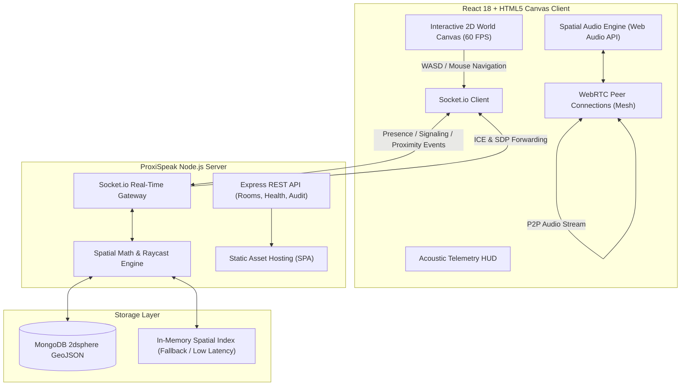
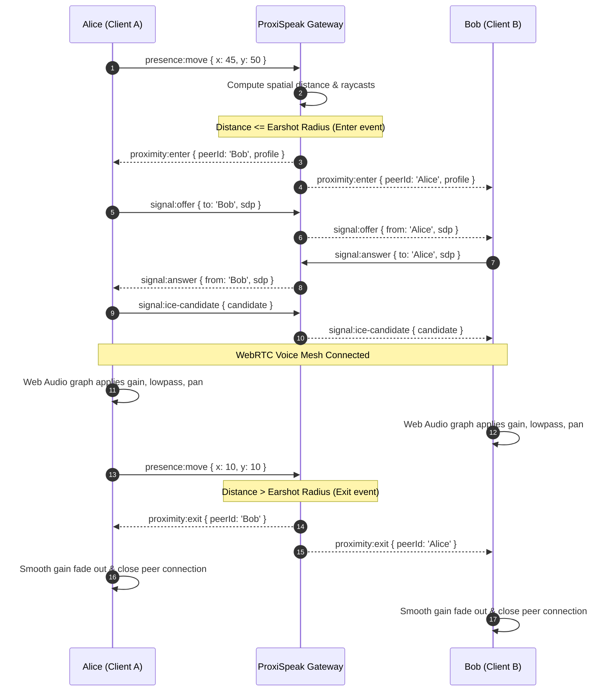

# ProxiSpeak — Geospatial Proximity Audio Platform

**ProxiSpeak** is a real-time virtual spatial audio ecosystem where **physical proximity is the volume knob**. Participants navigate an interactive 2D spatial canvas with customizable avatars; as two users walk inside each other's earshot radius, a WebRTC peer-to-peer audio connection automatically negotiates, crossfades in, and pans across stereo channels according to their relative angle. Physical obstacles and room walls cast acoustic shadows, applying dynamic low-pass filtering and decibel attenuation to emulate realistic behind-the-wall muffling.

---

## Architecture Overview



---

## Core Capabilities

- **Natural Geospatial Proximity**: Volume attenuates smoothly as avatars move apart. Within the inner threshold ($d \le 2\text{m}$), audio is crystal clear (100% gain). Beyond that, a smooth cosine curve fades the volume down to zero at the configurable earshot radius ($r = 20\text{m}$).
- **Acoustic Raycasting & Wall Occlusion**: Line-of-sight vectors between participants are checked in real-time against room walls. Occluded paths drop high frequencies via a low-pass filter ($\approx 400\text{--}480\,\text{Hz}$) and attenuate volume by $-18\,\text{dB}$ to $-32\,\text{dB}$, simulating drywall, glass, and concrete partitions.
- **Stereo Spatial Azimuth Panning**: Web Audio `StereoPannerNode` dynamically shifts audio between left and right channels based on the speaker's angular bearing relative to the listener's orientation.
- **Automated WebRTC Voice Mesh**: Audio connections negotiate transparently over Socket.io signaling without requiring room lobbies or manual dial-ins.
- **Zero-Friction Autonomous Bot Simulation**: Built-in harmonic acoustic bots (`Bot Maya`, `Bot Liam`, etc.) can be spawned at the touch of a button to test proximity fade, stereo panning, and wall muffling in a single browser window.
- **Turnkey Production Packaging**: The single Express backend hosts the REST API, Socket.io gateway, and pre-compiled React client, serving the entire application from a single port (`4000`).

---

## Mathematical & Acoustic Model

### 1. Proximity Gain Curve

Given distance $d = \sqrt{(x_2 - x_1)^2 + (y_2 - y_1)^2}$, minimum full-volume radius $d_{\min} = 2\text{m}$, and maximum earshot radius $d_{\max} = 20\text{m}$:

$$\text{Gain}_{\text{base}}(d) = \begin{cases} 
1.0 & \text{if } d \le d_{\min} \\
0.5 \left(1 + \cos\left(\pi \frac{d - d_{\min}}{d_{\max} - d_{\min}}\right)\right) & \text{if } d_{\min} < d < d_{\max} \\
0.0 & \text{if } d \ge d_{\max} 
\end{cases}$$

### 2. Line-of-Sight Wall Occlusion

Ray segments connecting listener $L(x_1, y_1)$ and speaker $S(x_2, y_2)$ are evaluated against each room wall $W(p_1, p_2)$ using computational geometry:

$$\text{Intersection}(L, S, W) \iff \text{CCW}(L, W_1, W_2) \ne \text{CCW}(S, W_1, W_2) \land \text{CCW}(L, S, W_1) \ne \text{CCW}(L, S, W_2)$$

When intersected:
- **Low-pass Cutoff**: Drops from $20{,}000\,\text{Hz}$ to $w_{\text{cutoff}}$ (e.g. $400\,\text{Hz}$ for glass, $250\,\text{Hz}$ for concrete).
- **Linear Occlusion Multiplier**: $G_{\text{occlusion}} = 10^{-\frac{\text{attenuationDb}}{20}}$.

### 3. Stereo Azimuth Panning

$$\theta_{\text{bearing}} = \text{atan2}(y_S - y_L, x_S - x_L) - \theta_{\text{listener}}$$

$$\text{Pan} = \sin(\theta_{\text{bearing}}) \in [-1.0, +1.0]$$

---

## Signaling & Audio Lifecycle



---

## Tech Stack

| Layer | Technologies | Description |
| :--- | :--- | :--- |
| **Backend** | Node.js (v18+), Express 4, Socket.io 4 | High-throughput async event server |
| **Geospatial Engine** | MongoDB (2dsphere, `$near`, `$geoWithin`) | Persistent geo-indexing with in-memory caching |
| **Acoustic Audio** | Web Audio API (`AudioContext`, `BiquadFilter`, `Gain`, `StereoPanner`) | Real-time spatial processing pipeline |
| **Voice Transport**| WebRTC (`RTCPeerConnection`, `getUserMedia`) | Direct peer-to-peer audio mesh streaming |
| **Frontend UI** | React 18, HTML5 Canvas API, Tailwind CSS | 60 FPS hardware-accelerated viewport |

---

## API & Gateway Specification

### REST Endpoints

| Method | Path | Description |
| :--- | :--- | :--- |
| `GET` | `/health` | System telemetry, uptime, memory, database mode |
| `GET` | `/api/rooms` | Catalogue of spatial rooms and dimensions |
| `GET` | `/api/rooms/:slug` | Single room details with acoustic zones and walls |
| `GET` | `/api/rooms/:slug/presence` | List active participants in a specific room |
| `GET` | `/api/spatial/audit` | Acoustic testbed (computes distance, dB loss, and occlusion) |

### Socket.io Events

| Event Channel | Direction | Payload |
| :--- | :--- | :--- |
| `presence:join` | Client $\to$ Server | `{ roomId, user: { name, color, earshotRadius } }` |
| `presence:init` | Server $\to$ Client | `{ self, room, users, walls }` |
| `presence:move` | Client $\to$ Server | `{ x, y, orientation }` |
| `presence:state`| Client $\to$ Server | `{ isSpeaking, isMuted, isDeafened, earshotRadius }` |
| `proximity:enter`| Server $\to$ Client | `{ peerId, peerSocketId, profile }` |
| `proximity:update`| Server $\to$ Client | `{ peerId, profile: { distance, gain, isOccluded, cutoffFreq, pan } }` |
| `proximity:exit` | Server $\to$ Client | `{ peerId }` |
| `signal:offer`  | Bidirectional | `{ toSocketId, fromUserId, offer }` |
| `signal:answer` | Bidirectional | `{ toSocketId, fromUserId, answer }` |
| `signal:ice-candidate` | Bidirectional | `{ toSocketId, fromUserId, candidate }` |
| `chat:send`     | Client $\to$ Server | `{ text, isWhisper: boolean }` |
| `simulation:spawn` | Client $\to$ Server | `{ count: number }` |
| `simulation:clear` | Client $\to$ Server | `{}` |

---

## Getting Started

### Prerequisites

- **Node.js**: v18.17+ or v20+ / v22+
- **npm**: v9+
- **MongoDB** *(optional)*: Connected automatically if running locally on `localhost:27017`; gracefully falls back to in-memory spatial index if not available.

### Installation

Clone and install dependencies:

```bash
# Clone the repository
git clone https://github.com/your-org/proxispeak.git
cd proxispeak

# Install server dependencies
npm --prefix server install

# Install client dependencies
npm --prefix client install
```

### Configuration

Copy the example environment configuration:

```bash
cp .env.example .env
```

Review environment defaults in `.env`:

```env
PORT=4000
NODE_ENV=development
MONGO_URI=mongodb://127.0.0.1:27017/proxispeak
CLIENT_URL=http://localhost:5173,http://localhost:4000
DEFAULT_EARSHOT_RADIUS=20
MIN_HEARING_DISTANCE=2
WALL_ATTENUATION_DB=18
WALL_CUTOFF_FREQ=480
```

---

## Running the Application

### 1. Production Mode (Single-Port Turnkey Deliverable)

Compile the React frontend into production static assets and run the unified server:

```bash
npm run build
npm start
```

Open your browser at **[http://localhost:4000](http://localhost:4000)**.

### 2. Development Mode (Concurrent HMR)

Run both the Express backend and the Vite HMR dev server concurrently:

```bash
# Terminal 1: Backend
npm run dev:server

# Terminal 2: Client
npm run dev:client
```

Open your browser at **[http://localhost:5173](http://localhost:5173)**.

---

## Interactive Controls & Evaluation Guide

1. **Avatar Movement**: Use `W`, `A`, `S`, `D` or arrow keys to move. You can also click anywhere on the canvas to pathfind to that point.
2. **Microphone & Audio**: Click the microphone icon or press `M` to toggle mute. Press `D` to toggle deafen.
3. **Acoustic Testing with Autonomous Bots**:
   - Click the **Spawn Bots** button in the bottom dock.
   - 3 autonomous bots (`Bot Maya`, `Bot Liam`, `Bot Sarah`) will enter the space and begin wandering and speaking with synthesized harmonic voice tones.
   - Walk toward a bot: hear the voice smoothly crossfade in and increase in volume.
   - Walk around the bot: observe stereo audio panning from left to right ear.
   - Walk behind a room wall: hear the voice immediately become muffled as the low-pass filter cuts frequencies above $400\,\text{Hz}$ and reduces volume.
4. **Spatial Telemetry HUD**:
   - Click the HUD icon or press `H` to toggle the live engineer diagnostic overlay.
   - View live distance (meters), gain percentage, wall occlusion status, low-pass filter frequency, and stereo pan value in real time.
5. **Spatial Chat**:
   - Open the chat drawer on the top right.
   - Toggle **Earshot Whisper**: messages will only be delivered to participants within physical earshot radius.

---

## License

Proprietary enterprise deliverable. All rights reserved.
